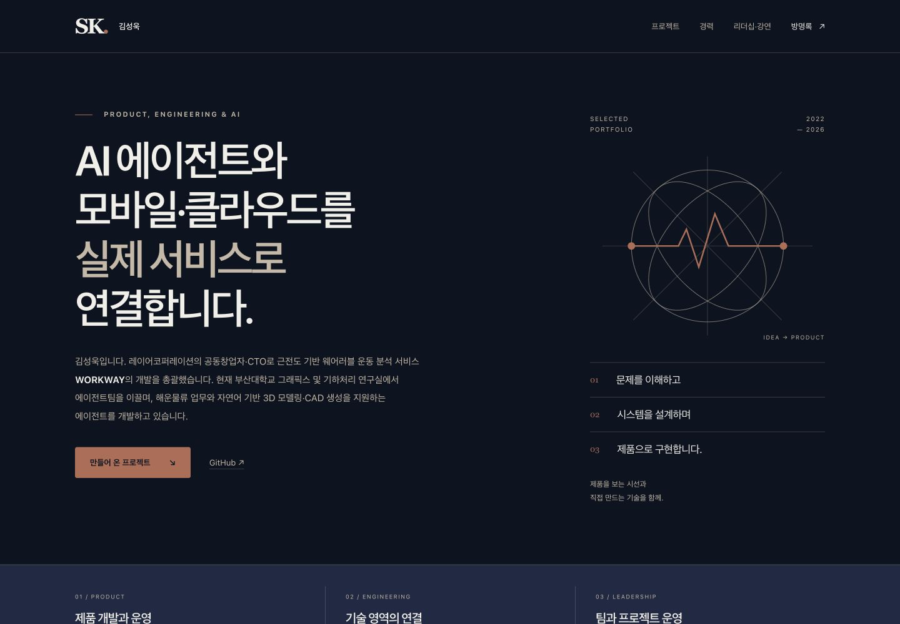
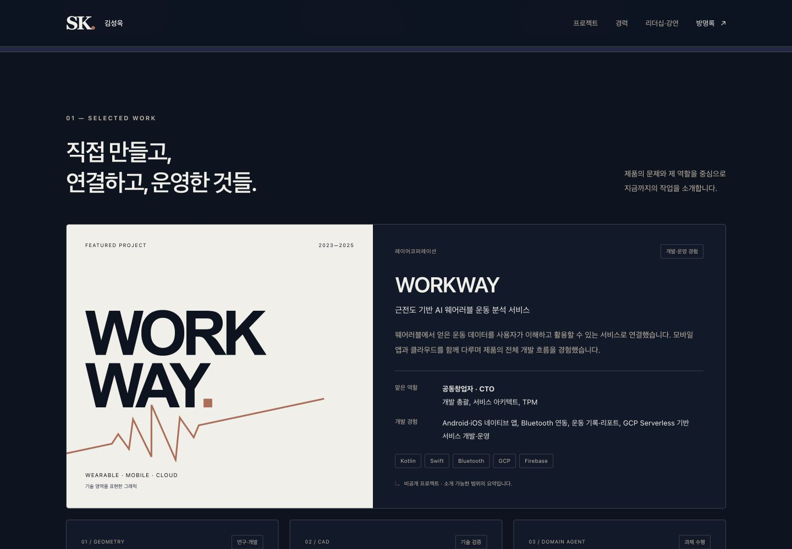
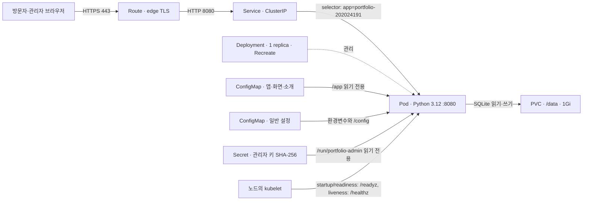
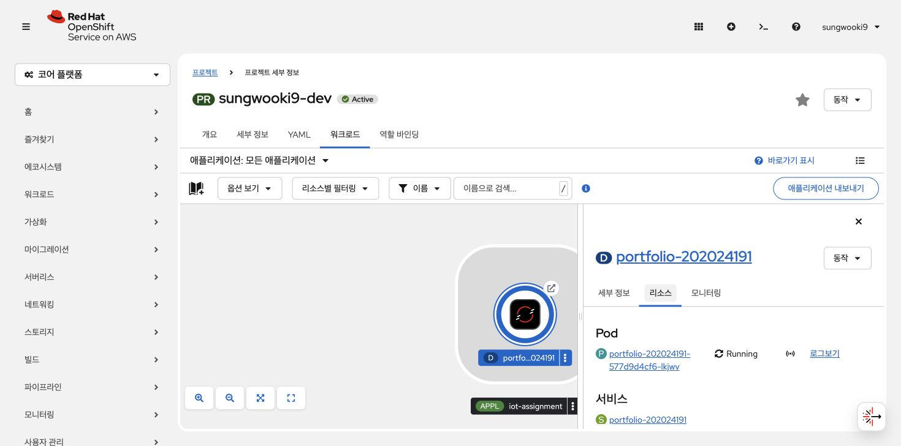
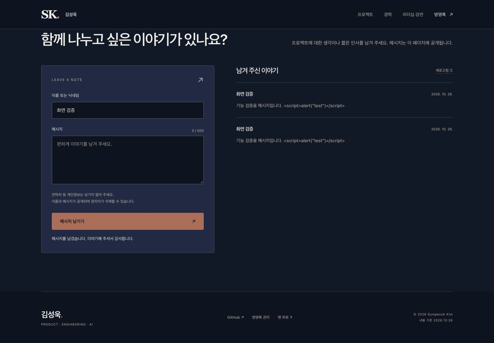
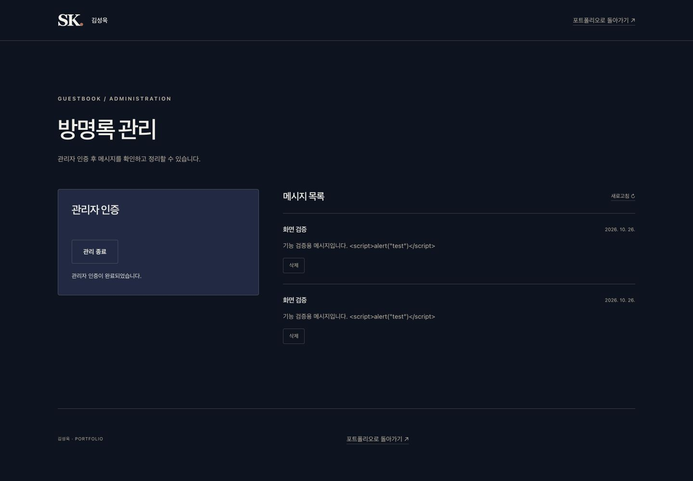
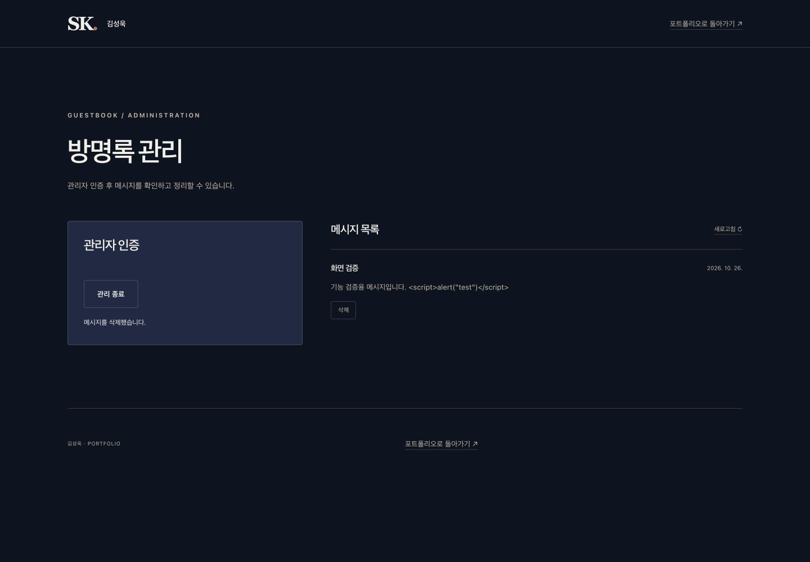
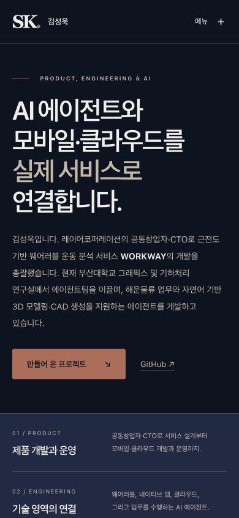
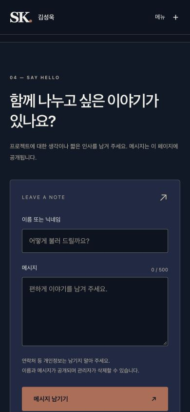

# 김성욱의 제품 개발 포트폴리오

지능형 IoT 플랫폼 · 과제 2 「나만의 컨테이너 만들기」 · **202024191 김성욱**

**AI 에이전트와 모바일·클라우드를 실제 서비스로 연결합니다.**

WORKWAY 공동창업자·CTO 경험에서 현재의 AI 에이전트 연구·개발과 창업 준비로 이어지는 포트폴리오입니다. 방문자는 방명록을 작성할 수 있고, 관리자는 인증 후 개별 메시지를 삭제할 수 있습니다. 이력과 프로젝트는 공개 가능한 설명만 정적 파일에 담았습니다.

- **실행 주소:** [HTTPS 포트폴리오](https://portfolio-202024191-sungwooki9-dev.apps.rm1.0a51.p1.openshiftapps.com/)
- **저장소:** [wannabidr/iot-container-portfolio](https://github.com/wannabidr/iot-container-portfolio)
- **관리 화면:** 실행 주소에 `/admin` 추가
- **검증 기준일:** 2026-10-26, Red Hat Developer Sandbox의 `sungwooki9-dev`
- **제출 마감:** 2026-10-30 10:00 KST

Sandbox는 임시 실습 환경입니다. 만료·절전으로 기존 주소가 응답하지 않더라도 아래 YAML로 새로운 OpenShift 프로젝트에 배포할 수 있습니다. Route host와 namespace는 제출 YAML에 고정하지 않았습니다.



## 1. 서비스 선정 이유와 기능

단순한 정적 페이지에 방명록을 더해 **외부 접근, 서버 실행, 설정 주입, 관리자 인증, 영속 데이터, 상태 점검**을 하나의 작은 서비스에서 확인하도록 구성했습니다. IoT 제품 개발 경험인 WORKWAY를 가장 크게 배치해 수업의 컨테이너 기술과 실제 제품 개발 경험을 연결합니다. 이 포트폴리오 자체가 웨어러블 데이터를 수집하거나 AI 모델을 실행하는 서비스는 아닙니다.

| 영역 | 구현 내용 |
|---|---|
| 소개 | 제품 개발·운영, 모바일·클라우드·에이전트 연결, 팀 운영 경험 |
| 프로젝트 | WORKWAY, IRIT-Agent, CADGen, 해운물류 에이전트 및 보조 프로젝트 3개 |
| 경력 | 제공한 경력 6개와 2025.09.19 AID 강연, 실제 프로젝트에 연결한 기술 |
| 방명록 | 이름/닉네임 1–40자, 메시지 1–500자, 최신순 목록·이전 글 조회 |
| 관리자 | 무작위 키 검증, 개별 삭제, 삭제 확인창, 관리 종료 |
| 화면 | 데스크톱·모바일, 명시적 입력 label, 키보드 초점·Escape, 상태 안내 |



## 2. 아키텍처와 Kubernetes Object



| 파일 | Object / 이름 | 역할·연결 |
|---|---|---|
| [deployment.yaml](k8s/deployment.yaml) | Deployment / `portfolio-202024191` | 앱 실행, 볼륨 연결, 자원 제한, 3종 Probe, 복제본 관리 |
| [service.yaml](k8s/service.yaml) | Service / `portfolio-202024191` | 같은 `app` label을 선택, 8080 → Pod의 named port `http` |
| [route.yaml](k8s/route.yaml) | Route / `portfolio-202024191` | Service의 `http` 포트를 HTTPS로 노출, HTTP는 HTTPS로 리다이렉트 |
| [configmap-app.yaml](k8s/configmap-app.yaml) | ConfigMap / `portfolio-202024191-app` | 서버와 HTML/CSS/JS/SVG 전체를 전달; 별도 다운로드 없음 |
| [configmap-settings.yaml](k8s/configmap-settings.yaml) | ConfigMap / `portfolio-202024191-settings` | 포트·DB 경로와 공개 프로필/방명록 문구 |
| [secret.yaml](k8s/secret.yaml) | Secret / `portfolio-202024191-admin` | 관리자 인증키의 SHA-256 검증값; 원문 키 미포함 |
| [pvc.yaml](k8s/pvc.yaml) | PVC / `portfolio-202024191-data` | SQLite DB·WAL을 Pod 수명과 분리; RWO 1Gi |

**요청 경로:** 브라우저 → OpenShift Router(HTTPS 종료) → Service → Python HTTP 서버 → SQLite. 정적 포트폴리오는 GitHub API나 비공개 저장소에 의존하지 않습니다. 컨테이너는 외부 패키지 설치 없이 Python 표준 라이브러리로 실행됩니다.

## 3. 이미지·포트·실행 설정

| 항목 | 값 |
|---|---|
| 공개 이미지 | `registry.access.redhat.com/ubi9/python-312` |
| 태그 | `1-1792838979` |
| 고정 digest | `sha256:26533737695d39d003558de435f54f52bd54879d8184a0d7038147d1ff3ea9bd` |
| 실행 명령 | `python3 /app/server.py` |
| 리슨 주소·포트 | `0.0.0.0:8080` / Service 8080 / 외부 HTTPS 443 |
| CPU | requests `50m`, limits `250m` |
| 메모리 | requests `64Mi`, limits `128Mi` |
| 임시 저장소 | requests `16Mi`, limits `64Mi`; `/tmp` emptyDir `32Mi` |
| 영속 저장소 | `1Gi`, `ReadWriteOnce`, 클러스터의 기본 StorageClass 사용 |
| 복제본·업데이트 | `1`, `Recreate` |

공개 UBI Python 이미지를 선택해 인증 없는 이미지 pull과 OpenShift의 임의 비루트 UID 실행을 지원합니다. 태그는 사람이 식별하기 위한 것이고 실제 바이트는 digest로 고정합니다. 제출 시 이미지 빌드·레지스트리 업로드·requirements 설치는 필요하지 않습니다. base image의 S2I 기능은 사용하지 않고 실행 명령을 명시했습니다.

`runAsNonRoot`, 읽기 전용 root filesystem, 권한 상승 금지, 모든 Linux capability 제거, RuntimeDefault seccomp, ServiceAccount 토큰 자동 주입 금지를 적용했습니다. UID/GID를 고정하지 않아 OpenShift가 프로젝트의 허용 범위에서 배정합니다. 파일 쓰기는 PVC와 `/tmp`에서만 이루어집니다.

## 4. 새 환경에 배포하기

사전 조건: `oc` 설치, Red Hat Developer Sandbox 로그인, 사용 권한이 있는 **활성 OpenShift 프로젝트** 선택. 기본 동적 StorageClass와 PVC 1Gi 이상의 여유가 필요합니다.

```sh
git clone https://github.com/wannabidr/iot-container-portfolio.git
cd iot-container-portfolio/students/202024191

# 콘솔의 로그인 안내에 따라 인증한 다음 본인의 프로젝트를 선택합니다.
oc project <본인-프로젝트명>
oc get resourcequota,limitrange
oc get storageclass

# 핵심: 이 디렉터리의 YAML만으로 앱 전체가 실행됩니다.
oc apply -f k8s/
oc rollout status deployment/portfolio-202024191 --timeout=180s
oc get pods,svc,route,pvc -l app=portfolio-202024191

PORTFOLIO_HOST=$(oc get route portfolio-202024191 -o jsonpath='{.spec.host}')
curl -fsS "https://$PORTFOLIO_HOST/healthz"
curl -fsS "https://$PORTFOLIO_HOST/readyz"
curl -fsS "https://$PORTFOLIO_HOST/api/guestbook"
```

예상 상태는 Pod `1/1 Running`, PVC `Bound`, 두 점검 경로 `200`, 초기 목록 `{"items": [], "next_before": null}`입니다. 브라우저에서 `https://<위에서 확인한 HOST>/`를 열면 포트폴리오가 나타납니다. 이미지 pull·볼륨 준비에 시간이 걸리면 rollout 완료를 기다립니다.

제출자의 실제 프로젝트는 `sungwooki9-dev`입니다. 다른 사람이 이 이름을 사용할 필요는 없으며, YAML의 모든 Object는 `oc`가 선택한 현재 프로젝트에 생성됩니다.

### 채점자가 자기 관리자 키로 재설정하기

기본 YAML만으로 포트폴리오·방명록 작성·목록이 작동합니다. 공개 저장소에는 관리자 **원문 키가 없으므로**, 삭제 기능을 검증하려면 본인의 배포 환경에서 새 키를 생성합니다. 생성 도구에는 Python 3.10 이상이 필요하지만 컨테이너 배포 자체에는 로컬 Python이 필요하지 않습니다.

```sh
python3 scripts/admin_key.py
# 이미 로컬 키가 있을 때만: python3 scripts/admin_key.py --rotate
oc apply -f k8s/
oc rollout status deployment/portfolio-202024191 --timeout=180s
```

새 무작위 키는 `.local/admin-key.txt`에 권한 `0600`으로 저장됩니다. 이 파일을 로컬 편집기로 열어 `/admin`에 입력합니다. 도구는 공개 가능한 SHA-256 검증값과 YAML도 함께 갱신합니다. 키 원문은 `.gitignore`로 제외되며 화면·URL·로그·브라우저 저장소에 기록하지 않습니다. 재설정은 **본인이 배포한 프로젝트에서만** 수행합니다.

Secret은 그 자체로 암호화를 보장하는 개념이 아닙니다. 이 서비스는 고엔트로피 무작위 토큰의 해시만 Secret에 보관하고 서버에서 상수 시간 비교를 수행합니다. 사람이 고르는 짧은 비밀번호를 단순 SHA-256으로 저장하는 방식으로 바꾸면 안 됩니다.

### 수정·로컬 실행

```sh
# 새 clone이라면 먼저 관리자 키를 생성합니다.
python3 scripts/admin_key.py
python3 scripts/run_local.py
# http://127.0.0.1:8080/ ; 종료는 Ctrl+C
```

앱 원본은 `app/`에 있습니다. 수정 후 다음을 실행하면 ConfigMap과 Deployment의 내용 checksum이 갱신됩니다. 체크인된 YAML이 이미 완성본이므로 채점자에게 이 생성 과정을 요구하지 않습니다.

```sh
python3 scripts/build_manifests.py
python3 scripts/build_manifests.py --check
python3 -m unittest discover -s tests -v
oc apply -f k8s/
oc rollout status deployment/portfolio-202024191 --timeout=180s
```

## 5. 데이터 보존과 완전 재배포

SQLite DB는 `/data/guestbook.sqlite3`에 기록합니다. 같은 PVC를 연결하면 Pod가 교체돼도 데이터가 유지됩니다. 하나의 DB 파일에 여러 Pod가 동시에 접근하는 상황을 피하려고 단일 복제본과 Recreate를 선택했습니다. 업데이트 중에는 짧은 중단이 발생할 수 있습니다.

```sh
# 현재 배포의 키가 로컬 .local/admin-key.txt와 같을 때 실행합니다.
# 자체 검증용 글 생성 → Pod 교체 → 같은 글 확인 → 해당 글만 삭제
python3 scripts/verify_live.py --persistence
```

**아래 완전 재배포 명령은 PVC도 삭제하므로 방명록 데이터가 초기화됩니다.** 초기화해도 되는 실습 환경에서만 사용합니다. 이번 제출물은 자체 검증용 글만 있는 상태에서 실제 삭제·재배포를 수행했습니다.

```sh
oc delete -f k8s/ --wait=true --timeout=180s
oc apply -f k8s/
oc rollout status deployment/portfolio-202024191 --timeout=180s
oc get pods,svc,route,pvc -l app=portfolio-202024191
```

이 명령은 `k8s/`에 정의된 과제 Object 7개만 대상으로 합니다. 프로젝트 전체를 삭제하거나 `oc delete all --all`을 사용하지 않습니다. 기존 데이터를 보존하며 코드를 갱신할 때는 삭제 없이 `oc apply -f k8s/`만 실행합니다.

## 6. 실행 결과와 평가 항목 대응

| 평가 항목 | 배점 | 구현·검증 | 증빙 |
|---|---:|---|---|
| 배포 성공 | 40 | 실제 Sandbox Pod Ready, HTTPS 정상, 최종 Git YAML만으로 전체 재배포 | [검증 보고서](docs/VERIFICATION.md), [클러스터 상태](docs/cluster-status.txt), [공개 clone 재배포](docs/public-clone-verification.json) |
| 문서 | 25 | 서비스·선정 이유·구조·이미지·배포·결과·문제 해결·AI 활용 | 이 README, 아래 실제 화면 |
| YAML 품질 | 20 | selector/포트 일치, 자원 제한, 이식 가능한 이름·설정, source 일치 검사 | [k8s/](k8s/), [YAML 해설](docs/YAML_GUIDE.md), [자동 테스트](tests/) |
| 추가 구성 | 15 | ConfigMap 2개, Secret, PVC, startup/readiness/liveness Probe | [실서비스 24개 검증](docs/live-verification.json), [검증 보고서](docs/VERIFICATION.md) |

실제 기능 검증 화면입니다. 스크린샷 속 메시지는 직접 생성한 검증 데이터이며 검증 후 삭제했습니다.






 

### API와 방어 동작

| 메서드·경로 | 기능 | 주요 응답 |
|---|---|---|
| GET `/`, `/admin` | 공개 포트폴리오·관리 화면 | 200 |
| GET `/api/config` | 공개 프로필 설정 | 200 |
| GET `/api/guestbook` | 최신 6개, `before` cursor, `limit` 최대 20 | 200 / 잘못된 query 400 |
| POST `/api/guestbook` | JSON `name`, `message` 작성 | 201 / 유효성 400 / 크기 413 / 형식 415 |
| GET `/api/admin/check` | Bearer 관리자 키 검사 | 200 / 인증 실패 401 |
| DELETE `/api/guestbook/{id}` | Bearer 인증 후 개별 삭제 | 204 / 인증 실패 401 / 없는 ID 404 |
| GET `/healthz` | 서버 생존 | 200 |
| GET `/readyz` | DB 읽기·쓰기 트랜잭션 후 rollback | 200 / DB 오류 503 |

DB query는 매개변수 SQL을 사용하며, 방문자 입력은 DOM `textContent`로 표시합니다. 교차 사이트 변경 요청은 403으로 차단합니다. 정적 파일은 허용 목록만 제공하므로 서버 코드·DB·Secret 파일은 내려받을 수 없습니다. 요청 본문 8KiB, 방명록 최대 1,000개, 동시 연결 32개, 작성·인증 요청 빈도 제한도 적용했습니다. 입력 오류·대기·성공·목록 없음 상태를 화면에 표시합니다.

실습 규모에 맞춘 Python 표준 라이브러리 HTTP 서버입니다. 대규모 서비스용 고가용성·백업·자동 스팸 방어·사용자 계정은 범위에 포함하지 않습니다. 요청 빈도 제한은 접속 peer 기준이므로 OpenShift Router를 통해 들어오는 방문자끼리 제한을 공유할 수 있습니다. `/readyz`의 쓰기 점검은 실제 데이터를 남기지 않습니다.

## 7. 구현 중 확인한 문제와 해결

1. **소스만 제출하면 `k8s/` 적용만으로 실행되지 않는 문제:** 모든 앱 자산을 ConfigMap에 묶었습니다. 외부 저장소 다운로드·패키지 설치 없이 시작하며, 원본과 YAML의 일치 여부를 테스트합니다.
2. **Pod 수명과 방명록 수명이 결합되는 문제:** DB 경로를 PVC에 두고 Pod를 실제 교체했습니다. 전후 Pod UID는 달라졌고 PVC UID와 메시지 내용은 같았습니다.
3. **공개 저장소와 관리자 인증의 충돌:** 무작위 원문 키는 로컬에만 두고 검증 해시를 Secret에 넣었습니다. 다른 환경에서는 제공한 도구로 자기 키를 생성할 수 있습니다.
4. **OpenShift의 임의 UID와 읽기 전용 파일 시스템:** UID를 고정하지 않고 앱·설정은 읽기 전용, 데이터는 PVC로 분리했습니다. 실제 클러스터에서 비루트 실행과 DB 쓰기를 확인했습니다.
5. **생성 도구 초안의 Python 괄호 오류:** YAML 생성 전에 문법 오류가 발견돼 수정하고, 원본 일치 테스트와 서버 측 dry-run을 통과한 뒤 배포했습니다.
6. **Sandbox의 일부 리소스 목록 권한 제한:** `oc get all`이 앱 상태 출력 후 `applications.app.k8s.io` 접근 거부로 종료 코드 1을 반환했습니다. 과제에서 사용하는 Object 종류를 명시해 별도로 조회했고, 원래 오류와 정상 상태를 함께 증빙에 남겼습니다.

위 1–4는 설계·검증 과정에서 해결한 제약이며, 발생하지 않은 장애를 재현한 것처럼 기록하지 않았습니다. 실제 검증 수치·시각·상태는 [검증 보고서](docs/VERIFICATION.md)에 분리했습니다.

## 8. AI·도구·참고자료 활용

이 과제는 **OpenAI Codex**의 도움으로 요구사항 분석, 콘텐츠 편집, HTML/CSS/JavaScript·Python·YAML 작성, 테스트 작성, 브라우저 검증, `oc` 배포와 문서화를 수행했습니다. 사이트 제작 skill의 화면 구성 지침을 참고했으며, 외부 사이트 호스팅이나 별도 웹 프레임워크는 사용하지 않았습니다. 경력의 기준은 본인이 제공한 이력과 승인한 소개 계획입니다. AI가 만든 문구는 프로젝트 역할·공개 범위를 대조했습니다.

사용 도구는 Python unittest, Node.js 문법 검사, Chrome 화면/키보드 검증, OpenShift CLI, Git/GitHub입니다. 제공된 과제 안내 PDF는 평가·제출 형식 확인에 사용했고 원본 강의 자료는 공개 저장소에 재배포하지 않았습니다. 이미지는 실제 앱 캡처이고 장식 그래픽은 SVG/CSS입니다.

참고한 공식 자료:

- [Red Hat Python 3.12 컨테이너 사용법](https://github.com/sclorg/s2i-python-container/blob/master/3.12/README.md)
- [OpenShift Route 문서](https://docs.redhat.com/en/documentation/openshift_container_platform/4.19/html/ingress_and_load_balancing/routes)
- [OpenShift CLI 문서](https://docs.redhat.com/en/documentation/openshift_container_platform/4.21/html/cli_tools/openshift-cli-oc)
- [Kubernetes Probe](https://kubernetes.io/docs/tasks/configure-pod-container/configure-liveness-readiness-startup-probes/)
- [Kubernetes Secret](https://kubernetes.io/docs/concepts/configuration/secret/)
- [Kubernetes Persistent Volume](https://kubernetes.io/docs/concepts/storage/persistent-volumes/)
- [Python http.server](https://docs.python.org/3.12/library/http.server.html), [sqlite3](https://docs.python.org/3.12/library/sqlite3.html)
- [Developer Sandbox FAQ](https://developers.redhat.com/developer-sandbox/FAQ)

콘텐츠 출처와 역할의 범위는 [CONTENT_SOURCES.md](docs/CONTENT_SOURCES.md), YAML을 설명하기 위한 정리는 [YAML_GUIDE.md](docs/YAML_GUIDE.md)를 참고합니다.

## 9. 제출 폴더

```text
students/202024191/
├── README.md
├── k8s/                  # 이 폴더만 oc apply 하면 실행
├── app/                  # 서버·정적 화면·공개 설정 원본
├── scripts/              # 로컬 실행, 키 생성, YAML 생성, 실제 서비스 검증
├── tests/                # 동작·보안 경계·YAML 테스트
├── images/               # 실제 브라우저·콘솔 캡처
├── docs/                 # 해설·검증·상태 기록
├── admin-key.sha256       # 고엔트로피 키의 공개 검증값
└── .gitignore            # .local/와 DB 등 제외
```

학번 폴더에 모든 제출물이 포함됩니다. 실행 중 비공개 GitHub 접근, 비공개 코드·자료·링크 공개, 관리자 원문 키 업로드는 없습니다.
